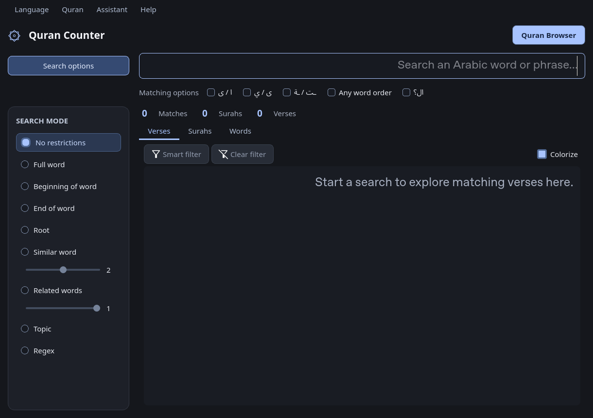
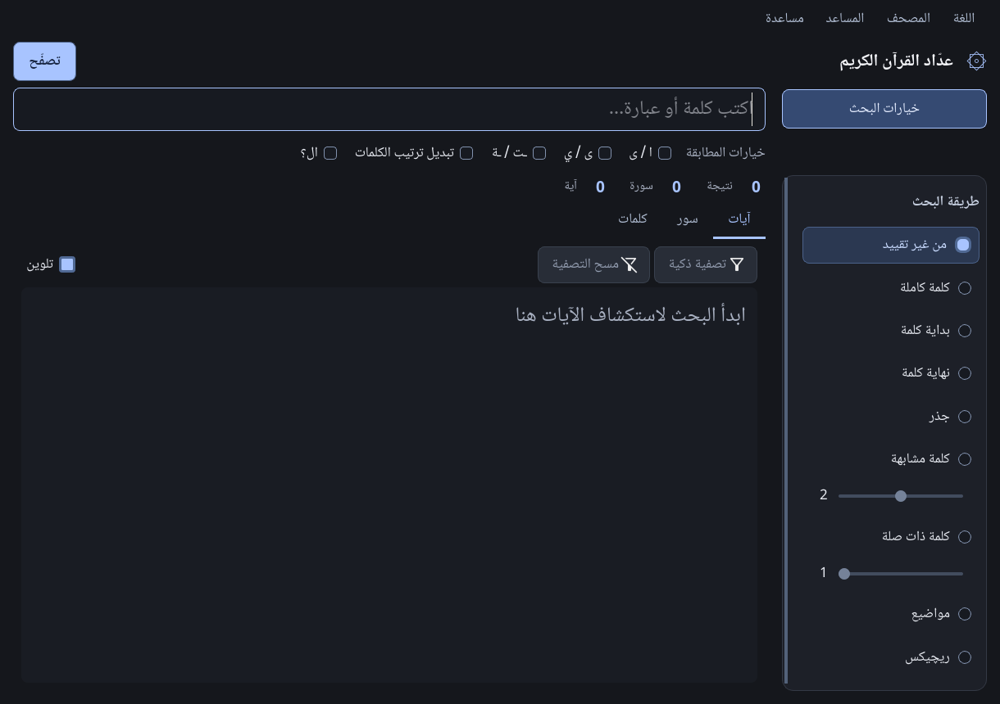

<div align="center">
  
</div>

**Quran counter** is a tool for fast and flexible semantic and syntactic search in the Holy Quran (`exe` download link [at the bottom](#notes)).

The desktop interface supports English and Arabic, with mirrored layouts and a charcoal and slate theme with soft blue accents across all screens. Search modes open by default and can be collapsed with **Search options** to give results the full width. Matching controls align directly beneath the query and reflect which options the selected mode supports. Switching modes keeps the query's size and focus stable; the button's tooltip includes the selected mode. The query and empty-results hint always align to the right, regardless of the interface language. Press **Ctrl+F** to focus search; results still update as you type.




The Quran browser separates **Reading** from **Statistics**, with expandable selection tools beneath the text. Detailed results, relation graphs, assistant setup and meaning selection, downloads, updates, and waiting dialogs share the same typography, surfaces, and controls. [View the complete English and Arabic screen gallery](docs/ui/README.md).

### UI development and validation

The presentation layers live in `gui/main_window/modern_main_window.py` and `gui/dialog_style.py`, with shared styling in `gui/theme.py`. They reuse the original Designer controls and custom result widgets. Continue editing/regenerating the `.ui` files as usual; `build.bat` does not overwrite these presentation layers. New interface text is localized in the language helpers, alongside the existing Qt translation catalogs.

Language switching requires compiled `.qm` catalogs. For a source checkout, run `python tools/compile_translations.py` after installing the dependencies. On Windows, `convert_to_exe.bat` now runs this step automatically before packaging and stops if compilation fails. Rebuild an older EXE to include the catalogs; `.ts` source files alone cannot enable runtime translation. The Windows build also needs the separately distributed `data/` directory and `embeddings/topics_embeddings.pkl`.

With the project's dependencies installed, run the Qt UI checks from the repository root:

```sh
python -m unittest discover -s tests -v
python tools/render_ui_preview.py --language en --output work/english.png
python tools/render_ui_preview.py --language ar --output work/arabic.png
python tools/render_dialog_previews.py --output-dir work/dialogs
```

The tests cover production language-menu actions, missing-catalog recovery, right alignment, preserved control signals and state, keyboard navigation, and focus/geometry stability across all nine search modes in both languages at two window sizes. Dialog checks cover translation, visible control bounds, reader navigation and selection tools, detail closing, key input, meaning selection, and download progress. With options open, results occupy over 70% of the width and 55% of the height at the default 1220 × 860 size in both languages; collapsing modes restores over 95% of the width. Tests use the real forms and action wiring without starting data workers. Previews use deterministic sample content, not live search or network results. Full application and Windows EXE testing still require the separately distributed data and embeddings. The feature screenshots below show earlier versions.

Here's a breakdown of some of the various features the app provides:

* No restrictions search (substrings):


You could also apply smart filtering (using ChatGPT) by clicking the filter button:


You can also see the results breakdown by word count:


* Beginning of word search:


* End of word search:


* Full word search:


* Root search (words with the same root):


* Similar words search (syntactic similarity):


* Related words search (semantic similarity):


You could also see the similarity path between the source and destination words:

  
  


<i>data from http://corpus.quran.com</i>

* Topic search (using an AI model I developed and trained):


<i>I may provide the source code for the model in the future<i>

* Regex search:


* Quran browser:


As you can see there are several features in the Quran Browser window. For example:
- Number of words inside selection.
- The Surah's unique words number.
- The Surah's most repeated word.
- Exclusive phrases in the Surah (words or phrases that don't appear in other Surahs).

---

### Notes

* Windows binaries can be found at sourceforge.net:
https://sourceforge.net/projects/qurancounter/

<h3>Future work</h3>

* I'm planning to add a feature to compare between the 10 Qiraat (recitations) of the Quran **(I'm looking for volunteers - no experience required)**.
* Create a web app version **(looking for volunteers - required experience: C++, Python, Qt)**

<h3>Special Thanks</h3>

* Dr. Yahya Mir Alam (در. يحيى مير علم) & Dr. Michel Bakni (در. ميشيل باكني) for providing the grammatical particles list.
* Mr. Ali Aloush (علي علوش) for reviewing and testing the app.
* Reem Masalha for reviewing and testing the app.

---

<h4><i>Developed by: https://github.com/masalha-alaa/quran-counter/</i></h4>
